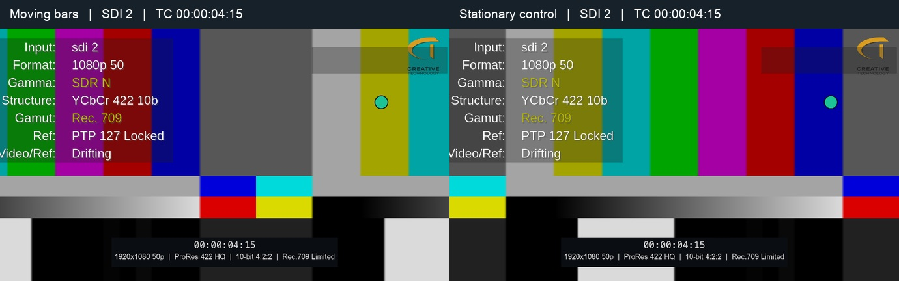

# 1080p50 ProRes HQ on the UltraStudio HD Mini

A later [Shogun frame-by-frame investigation](shogun-flicker.md) captured a separate bottom-edge strip at 0.860 s on physical SDI 1. The moving white patch described below accounts for a different observation. Shogun playback qualification remains open.

On 25 November 2026 the UltraStudio played the 10-second moving-bars monitor export through its DeckLink driver into physical SDI 2 on the PRISM. The white patch visible between four and six seconds followed the source pattern through both the encoder and SDI output.

## Inputs and signal

The PRISM presets labelled “sdi 1” and “sdi 2” initially both pointed to physical port 0. Before playout we assigned “sdi 2” to port 1 and confirmed the PRISM source readback was **SDI 2, Port 0:1**. The Shogun reading below was taken from physical SDI 1 before that change.

| Playback source | PRISM input format | ST 352 payload | Transport flag | Picture flag |
| --- | --- | --- | --- | --- |
| Shogun on SDI 1 | 1080p50, 3G Level A | `89 49 00 01` | Interlaced | Progressive |
| UltraStudio on SDI 2 | 1080p50, 3G Level A | `89 C9 00 01` | Progressive | Progressive |

The UltraStudio reported the expected scan flags for this 1920×1080, 10-bit 4:2:2 SDR mapping. The difference follows the playback path. [SMPTE ST 425-1, Table 1 and §4.1.6.2.1](https://pub.smpte.org/pub/st425-1/st425-1-2017.pdf) · [PRISM status during DeckLink playback](decklink-1080p50-status.jpg)

## File and picture

SGNCL was unmounted during this test. The original render recipe reproduced the delivered MOV with SHA-256 `ffe87de0148423f7ecbe893709f4832d1a867cae35b4f1e36a2803c75cbccc85`, matching its delivery record. The file verifier decoded all 500 progressive frames at 50 fps with no cadence errors, adjacent duplicates or loop findings. An FFV1 copy of the encoder input provided a lossless reference. Comparing against that tap alone would also reproduce any pattern-generation error.

We independently calculated where the plate's white patch should appear. At 1920 pixels wide it starts at x=548 and ends just before x=960. The pattern travels one screen width to the left in 500 frames. At the rightmost bottom pixel the patch crossed the midpoint between black and white at frame 143 (2.86 s) and stayed above it through frame 250 (5.00 s). It then continued moving left across the lower-right region. [SMPTE RP 219-2002, Annexes B and C](https://pub.smpte.org/doc/rp219/20020619-pub/Rp219-2002.pdf)

For frames 200–300 inclusive we checked every luma sample from x=1456 to 1919 and y=810 to 1079, outside the caption. Across **12,653,280 samples**, both the reference and the decoded MOV agreed with the predicted white mask at every position. The largest ProRes-to-reference luma difference was **2 codes on the 10-bit scale**. The regression test now follows the white patch on the bottom scan line across all 500 frames, including wraparound.

## Physical playout

GStreamer decoded ProRes into 10-bit v210 and used the DeckLink 1080p50 Level A output with stereo 48 kHz PCM. A first three-cycle run reached end of stream. Between the initial 525i idle reading and the first locked 1080p50 sample the PRISM registered field-length, line-length, EAV and SAV errors. Those totals held steady during the clip.

A second 60-second run used ten seconds of moving bars for acquisition, three more complete moving-bar cycles and two cycles of a stationary-bars control. Every compressed video packet in this sequence matched the corresponding input packet hash, with 3,000 consecutive picture timestamps. All 20 PRISM samples between seconds 3 and 58 reported the same progressive Level A payload on physical SDI 2. The SDI error totals and inactive-second counters stayed constant across that window, including both loop joins. Luma and chroma CRC error totals were zero. The player reached end of stream.

Twelve PRISM screen captures were matched by their burned-in timecodes. At one scan line near the bottom of each displayed picture, the white patch boundaries matched the predicted positions to the displayed pixel. The guard run caught the same timecode on each of the three moving-bar cycles. The instrument screenshots sample the SDI output. The frame-by-frame pixel comparisons were performed on the file.

The stationary control uses the same logo, timecode, label, moving ball and encoder. The file verifier raised one near-static-picture advisory. Independent tracking found the ball at the expected position on all 500 frames with zero repeated consecutive positions. The corner remained dark throughout the reported interval. This control makes an unexpected white flash easier to distinguish on a monitor.

The ProRes HQ export uses `prores_ks` profile 3. The dashboard speed preset applies to the custom H.264 and HEVC encoders. The observed patch is already present before ProRes encoding. [FFmpeg ProRes encoder options](https://ffmpeg.org/ffmpeg-codecs.html#ProRes)
