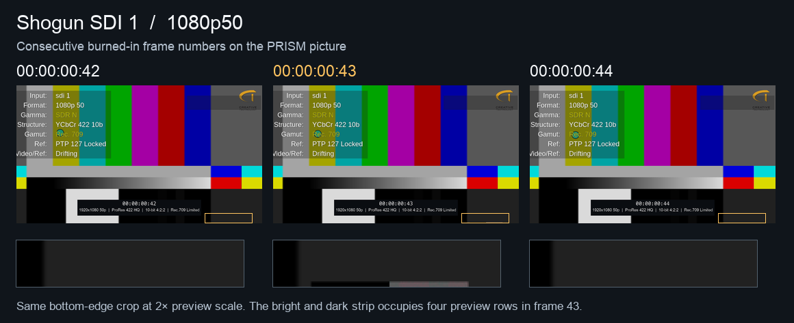

# Shogun playback flicker at 1080 HD

**Follow-up on the Apple-encoded replacement.** A continuous 1080p50 capture from the Shogun found a clean bottom edge at frame 43 on all three visits. Four other timecodes showed bottom-edge corruption and the tone dipped at every loop join. [SDI return recording, comparisons and measurements](shogun-sdi-return-1080p50.md)

**25 November 2026. Shogun playback qualification remains open.** The PRISM picture from Shogun SDI 1 showed a repeatable bright and dark strip at the bottom right of the 1080p50 export at `00:00:00:43` (0.860 s). It disappeared when the player returned to frame 42, reappeared on frame 43, and disappeared on frame 44. The [earlier DeckLink benchmark](decklink-1080p50.md) traced a larger moving white calibration patch. That finding did not explain this smaller transient.

## Shogun Classic compatibility

The operator confirmed the recorder is a **Shogun Classic running AtomOS 10.45.01**. Atomos lists that version as current for the Classic. Its 29 January 2025 release notes document one change to the real-time clock for dates after 2024. They list no ProRes playback, SDI picture or flicker fix. [Classic firmware listing](https://www.atomos.com/product-support/?parent=shogun) · [Classic 10.45.01 release notes](https://www.atomos.com/wp-content/uploads/2025/01/AtomOS_10.45.01_Shogun_Classic_Release_Notes.html)

All 40 delivered files probe as QuickTime MOV with ProRes 422 HQ (`apch`), 10-bit 4:2:2 limited-range Rec.709, and one stereo 24-bit 48 kHz linear PCM track. The 1080p50 file contains 50 progressive pictures per second. The 1080i50 file contains 25 frames per second with two time-separated fields per frame. The Classic lists ProRes HQ playback with linear PCM, 1080 progressive through 120p on SDI, 1080i50 on SDI, and loop playback. Both affected 50 Hz formats fit that specification. PRISM also directly established that the Classic opened and output the 50p file. [Classic playback specifications](https://www.atomos.com/tech-specs/shogun-classic/)

Fourteen files fall outside the Classic’s listed raster and scan combinations. These comprise ten 2560×1440 files, two interlaced 1280×720 files and two interlaced 3840×2160 files. The vendor lists 720p and UHD progressive through 60p. Its Classic page gives only a ceiling for 720p, so leave the five 720p exports from 23.98 to 30 fps unqualified pending playback at their native cadence. For 1080i59.94 the global page lists 1080i60 without a separate 1080i59.94 entry. The earlier PRISM observation independently established a 1080i59.94 output on this unit. [Classic resolution and frame-rate table](https://www.atomos.com/tech-specs/shogun-classic/)

Atomos Japan directs Classic owners to the Shogun 7 operating manual. Its playback section describes recorder-originated clips and requires the same codec, resolution and frame rate within a playlist. The Classic specifications do not identify a tested FFmpeg encoder or muxer, and I found no Classic-specific guarantee for externally authored MOVs. Apple separately identifies third-party ProRes interoperability as a possibility. For the frame-43 comparison, use a single 1080p50 clip at a time. Compare the original and Apple HQ control with a 1080p50 ProRes HQ recording made by the Classic itself from a verified clean SDI input. The latter tests the recorder's own supported recording-to-playback workflow. [Classic manual reference](https://www.atomos-japan.com/products/shogunclassic) · [Atomos playback manual, pp. 36–37](https://s3.ap-southeast-2.amazonaws.com/uploads.atomos.com/wp-content/uploads/2021/02/01051808/Atomos-Shogun7-UserManual-V01-NOV2019.pdf#page=37) · [Apple ProRes interoperability guidance](https://support.apple.com/en-gb/118584)

## Where the pictures diverge

The affected rectangle covers x=690–804 and y=481–484 in the 862×485 PRISM preview. All 460 pixels differ from the grey just above by more than 16 codes in at least one 8-bit display channel. The difference ranges from −33 to +78. At the same coordinates, both neighbouring frame previews agree exactly with the grey above. [Four lossless PRISM picture-tile captures, including both visits to frame 43](shogun-prism-frames.zip)

In the 1920×1080 picture this maps to approximately x=1536–1791, y=1072–1079. The lossless encoder input and two independent decodes of the delivered 1080p50 MOV give exactly the same 10-bit values throughout that rectangle on all three frames (Y′=195, Cb=512, Cr=512). The local MOV's SHA-256 matches the delivery record. The copy on the Shogun's own media was unavailable for hashing.

The rectangle lines up with two ProRes slices in the last macroblock row. This file uses eight 16-pixel macroblocks per slice, or 128 pixels across. At 1080 lines only eight lines of the last row are visible. The two corresponding slice payloads, indices 1017 and 1018, are each 19 bytes and byte-identical on frames 42, 43 and 44. All 500 progressive frame packets had consistent frame sizes and slice-table lengths. This makes the interaction between the stored file and the player worth testing. The geometry alone cannot identify the failing component. [SMPTE RDD 36:2022, §§4 and 7.5.3](https://pub.smpte.org/pub/rdd36/rdd36-2022.pdf)

## What the file tests covered

The three local exports matched their delivery hashes. Each decoded picture was compared in native 10-bit Y′CbCr 4:2:2 against the lossless output of the compositing graph. Each was also decoded with macOS AVFoundation and compared against FFmpeg over the complete raster. To check the compositor itself, the expected horizontal shift was calculated for every frame or field and applied to the initial bar plate. That test included all exposed luma edges and the interiors of flat chroma patches. The logo, caption and moving ball were excluded only from the plate comparisons.

| Export | Decoded frames | Largest FFmpeg vs Apple difference anywhere, Y′ / Cb / Cr | Largest MOV vs lossless difference outside graphics, Y′ / Cb / Cr | Largest lossless vs predicted plate difference |
| --- | ---: | --- | --- | ---: |
| 1080p50 | 500 | 1 / 1 / 1 | 5 / 5 / 8 | 0 |
| 1080i50, top field first | 250 | 1 / 1 / 1 | 9 / 7 / 8 | 0 |
| 1080i59.94, top field first | 300 | 1 / 1 / 1 | 13 / 8 / 7 | 0 |

In the bottom quarter of the 1080p50 export, the decoded luma stayed within two codes of the predicted moving plate across 195,082,476 exposed pixels. The one-frame brightness test included the loop join. It found zero exposed pixels brighter than both neighbours by more than 64 codes. Graphic edges had larger encoding differences and were retained in the full-picture decoder comparison. [Measurements and file hashes](shogun-flicker.json)

## The fifteen reported positions

The table treats the supplied times as seconds and a zero-based frame or field number. The 1080i50 burn-in counts 25 frames per second, with two time-separated fields in each frame. If the numbers came from stepping a 50-field timeline, the last column identifies the corresponding field. For every valid interpretation the file review also covered both neighbouring frames. The JSON records middle-third, right-edge and exposed-plate results for each three-frame window.

| Mark | 1080p50 frame | 1080i50 frame if read from burn-in | 1080i50 frame and field if counting fields |
| --- | ---: | ---: | --- |
| 00:43 | 43 | — | 21 bottom |
| 03:15 | 165 | 90 | 82 bottom |
| 03:19 | 169 | 94 | 84 bottom |
| 03:26 | 176 | — | 88 top |
| 04:01 | 201 | 101 | 100 bottom |
| 06:10 | 310 | 160 | 155 top |
| 06:18 | 318 | 168 | 159 top |
| 06:22 | 322 | 172 | 161 top |
| 07:29 | 379 | — | 189 bottom |
| 08:03 | 403 | 203 | 201 bottom |
| 08:07 | 407 | 207 | 203 bottom |
| 08:12 | 412 | 212 | 206 top |
| 09:04 | 454 | 229 | 227 top |
| 09:06 | 456 | 231 | 228 top |
| 09:21 | 471 | 246 | 235 bottom |

At **03:19**, the reported green gash, the largest difference from the lossless input anywhere in the middle third was **3 / 3 / 3** codes on 50p frame 169 and on 50i frames 94 and 84. At **03:26** and **04:01** the far-right 128 columns of the 50p file differed by at most **1 / 1 / 1** outside the graphics. The corresponding 50i readings peaked at two codes. None of those local comparisons reproduced the reported gash or right-edge flash.

**Physical coverage.** The burned-in profile and PRISM format identified 1080p50 in the first part of the capture. There were 144 matched screenshots covering 23 distinct frame numbers, including two visits to frame 43. A later set of 530 screenshots showed one held 1080i59.94 picture. The bench had no locked DeckLink capture return during the check. A continuous recording of the Shogun output covering the other fourteen marks and the loop join is still missing. Green SDI CRC status can coexist with a wrong picture already present at the transmitter.

## Encoding settings and the hardware comparison

The linked x264 experiment concerns 4:2:0 H.264, including deblocking and quantisation controls. Our monitor MOVs use the 10-bit 4:2:2 ProRes HQ branch, which does not read the dashboard's speed preset. Slowing that preset would produce the same ProRes command. Temporal sampling can make a moving sharp edge appear to strobe, but it would not create the measured pixel changes in this locally uniform grey patch. [Original screen-recording experiment](https://video.stackexchange.com/questions/23471/how-do-i-avoid-objects-having-flickering-edges-when-i-encode-a-screen-recording) · [Generator encoder selection](../../engine.py) · [FFmpeg ProRes options](https://ffmpeg.org/ffmpeg-codecs.html#ProRes) · [BBC R&D motion study, §2.2](https://downloads.bbc.co.uk/rd/pubs/whp/whp-pdf-files/WHP282.pdf)

**A separate loss of detail in the encoded graphics is reproducible in software.** On 50p frame 43 the label pixel at x=1080, y=983 changes from luma 613 before encoding to 473 in the delivered file. Apple's control decodes to 613 there. All 95 luma errors over 64 codes on that frame lie inside the caption region. The original slice containing that pixel has a quantiser of 42. The slices under the observed SDI strip have a quantiser of 4 and decode to the correct grey. FFmpeg documents how its encoder selects quantisers by slice to meet a size budget. [FFmpeg ProRes rate control](https://ffmpeg.org/ffmpeg-codecs.html#Speed-considerations)

Re-encoding the lossless input with the same FFmpeg HQ profile and an explicit fixed quantiser (`-qscale:v 1`) greatly reduced the worst error across each complete loop. The local comparison below includes every pixel and graphic. Each cell gives the **peak 10-bit luma error** and the **average compressed video rate in Mb/s**, in that order. An input with more detail could have a different bitrate. Shogun playback of the revised encodes remains untested.

| Export | Original FFmpeg HQ | FFmpeg HQ, fixed quantiser 1 | Native Apple HQ |
| --- | ---: | ---: | ---: |
| 1080p50 | 155 / 67.8 | 4 / 76.9 | 2 / 79.0 |
| 1080i50 | 241 / 40.7 | 4 / 47.5 | 3 / 48.1 |

The earlier reference check passed these original MOVs. It compares half-frame error distributions and samples flat patches, so a few large errors at an edge can pass. Measuring peak error on high-contrast captions in native 10-bit values catches that loss. The same test on the delivered bottom-edge rectangle finds correct grey values. The SDI failure still needs a hardware comparison.

Apple documents interoperability issues with some third-party ProRes implementations, including FFmpeg. The next comparison uses the same ten-second content, graphics and audio. The playable control MOVs are in `outputs/shogun-playback-controls/`. [Apple’s ProRes interoperability guidance](https://support.apple.com/en-gb/118584)

| Playback file | What it tests | What was verified locally |
| --- | --- | --- |
| Original SGNCL delivery | Reproduce the failure on the same player and media | Delivery hash and two independent full-picture decodes |
| `*_Remux_AB.mov` | Changes the MOV layout while retaining the original compressed video | Every video and PCM packet payload, timestamp and duration matched the original. The file offset of the first video packet changed. |
| `*_FFmpegQ1_AB.mov` | Tests finer quantisation with the original ProRes encoder | Same compressed pictures as the full-raster quantiser experiment, original PCM and timing, and file and loop verification. |
| `*_AppleHQ_AB.mov` | Encodes the same lossless pictures using Apple's native ProRes HQ encoder | File and loop checks passed. PCM matched the original. The interlaced control contains two field pictures in all 250 compressed frames, top field first. |
| `*_TopFieldTag_AB.mov` (50i only) | Isolates how the player interprets the MOV field-order tag | A single byte in the original MOV changes its `fiel` detail from 9 to 1, matching the Apple control. Encoded fields, sound, timestamps and packet offsets are identical to the original. |

Start with 1080p50, where the original has a captured failure. Compare the original, remux, fixed-quantiser and Apple files on the same Shogun media at frames 42–44 and record complete loops from the SDI return. Repeat with 1080i50, preserving both fields. FFprobe reports `tb` for the original interlaced MOV stream and `tt` for the Apple control, while the decoded pictures in both are top field first. The one-byte control separates that metadata difference from the encoder change. [FFmpeg MOV field-tag parsing](https://www.ffmpeg.org/doxygen/trunk/mov_8c_source.html)

A change with the remux would implicate the container layout or how the media is read. If the original and remux both fail on 50p and the Apple-encoded file plays cleanly, investigate how the player handles the original ProRes stream. If both controls fail, compare a Shogun-native recording of a known-clean input and verify the on-device file hashes. Qualification for critical-system playback remains open until the physical return passes.
