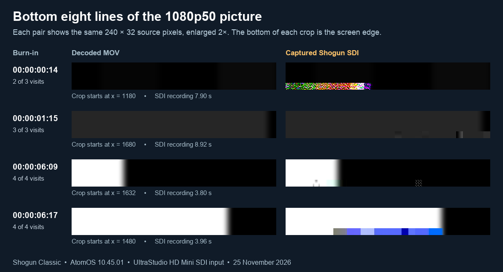

# Shogun Classic SDI return at 1080p50

**25 November 2026 · Playback qualification failed.** The UltraStudio HD Mini captured 36 seconds of the Shogun Classic running AtomOS 10.45.01 and looping the updated 10-second moving-bars clip. Thirteen captured pictures showed large brightness errors along the bottom edge at four distinct source timecodes. The embedded stereo tone dropped around all three loop joins.

## Where to look in the recording

Use the burned-in timecode to identify a picture in the ten-second source. The recording starts partway through the clip at `00:00:02:19`. The recording offsets below point to the first observed failure at each source timecode.

| Source burn-in (50 fps) | Recording offset | Affected visits | Affected horizontal span¹ | Peak luma difference² |
| --- | ---: | ---: | ---: | ---: |
| 00:00:00:14 | 7.90 s | 2 of 3 | 1152–1791 | 927 |
| 00:00:01:15 | 8.92 s | 3 of 3 | 1880–1919 | 158 |
| 00:00:06:09 | 3.80 s | 4 of 4 | 1664–1791 | 366 |
| 00:00:06:17 | 3.96 s | 4 of 4 | 1536–1663 | 845 |

¹ Inclusive horizontal bounds of pixels differing by more than 64 luma codes on the first affected visit. All four spans fall in rows 1072–1079, the last eight lines of the 1080-line raster.

² Largest absolute difference between the captured picture and the decoded MOV in that strip, in native 10-bit luma codes. At `00:00:00:14` one sample rose from 82 in the file to 1009 on SDI. The bottom-eight-line luma on the middle visit to that same frame matched the file exactly.

At all fifteen previously reported timecodes, bottom-eight-line luma matched the updated 1080p50 MOV exactly on every visit. The two six-second failures occurred one frame before the reported `06:10` and `06:18`. At `03:19`, the four visits showed no comparable green gash in the flat central bars. The peak differences in locally flat areas of the middle third were 2 luma codes and 1 code in each chroma channel. This capture covers progressive 50 Hz. The interlaced clips require separate field-by-field measurements.

## Loop and capture integrity

The moving bars and burned-in timecode independently identified the source frame on all 1,800 captured pictures. All 500 source frames appeared in order at their expected phase. The sequence went directly from frame 499 to frame 0 at 7.62, 17.62 and 27.62 seconds into the capture.

The local MOV contains a continuous 1 kHz tone, identical on both channels, whose 48-sample period closes exactly over the ten-second loop. The SDI audio deviated from that tone 399.3 ms before each picture join, fell to near silence, then took 171.3 ms after the join to recover. In the 395.8 ms immediately preceding each join, the peak was just one 24-bit PCM code from digital silence. Both channels did the same thing on all three joins. The receiver continued delivering 960 stereo sample frames per picture throughout.

The DeckLink SDK reported locked 1920×1080 progressive at 50 Hz. The capture recorded native 10-bit 4:2:2 video and 48 kHz stereo PCM. All 1,800 video timestamps and 1,800 audio packet timestamps were contiguous, with zero no-input flags. The evidence image uses the original v210 samples. The archive preserves the active-picture samples and stereo PCM.

## What the comparison establishes

The stored reference was the Apple-encoded ProRes 422 HQ replacement. A separate test compared caption pixels where the earlier FFmpeg encode and the replacement differ by at least 32 luma codes. Over 2,015,001 observations, the mean absolute luma difference from the SDI return was 0.14 codes for the replacement and 45.26 for the earlier encode. This identifies the playback version with strong picture evidence. The file on the Shogun’s own media was unavailable for a direct checksum.

The local decoded MOV is clean at the affected pixels. The clean and corrupt visits to `00:00:00:14` also show that a fixed error in that source picture alone cannot explain this return. Slower export settings have no demonstrated corrective effect on this failure. To distinguish a player or media-read problem from an interaction with externally authored MOVs, the next control is a Shogun-native recording of verified clean 1080p50 SDI played back over this same capture path.

The [measurements and checksums](shogun-sdi-return-1080p50.json) list all affected capture indices, all fifteen operator timecodes and each audio join. The release includes both recordings and the original timestamp log.

- [QuickTime review recording with stereo PCM](https://github.com/rhysjoseph/ffmpeg-video-generator/releases/download/v1.0.0/Shogun-SDI-1080p50-review.mov)
- [Lossless FFV1 recording with captured stereo PCM](https://github.com/rhysjoseph/ffmpeg-video-generator/releases/download/v1.0.0/Shogun-SDI-1080p50-lossless.mkv)
- [Original hardware timestamp log](https://github.com/rhysjoseph/ffmpeg-video-generator/releases/download/v1.0.0/timestamps.csv)
